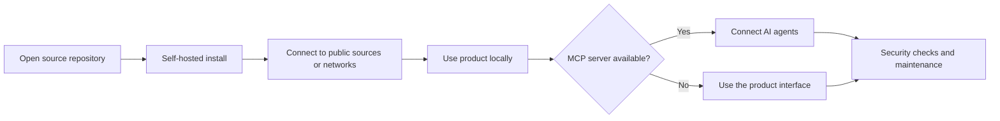

  

  
  
  
  

<h3 align="center">Infrastructure you own. Tools your AI agents can use. No API keys, no usage caps.</h3>

---

### What we build

Ethos 6 builds free, open-source building blocks that people and AI agents can run themselves: web search, document intelligence, storage, live data feeds and security tooling. Everything runs on your own machine or server, talks directly to open sources, and is MIT-licensed.

### Products

| Product | What it does | Built with |
|---|---|---|
| **[freeflow](https://github.com/Ethos6/freeflow)** | Keep coding when the free tier runs out. Runs Claude Code, OpenCode, Aider and any coding agent on 58 model providers, and moves each request to the next provider when one hits its limit. | JavaScript · CLI · Dashboard |
| **[masterly](https://github.com/Ethos6/masterly)** | Learn anything from your own material. Turns notes, textbooks and papers into a course: concepts in learning order, practice questions that quote your sources word for word (verified by code), and spaced repetition. | JavaScript · Web app · CLI |
| **[Free Search API](https://github.com/Ethos6/free-search-api)** | Keyless, unlimited web search API. Drop-in replacement for Tavily, Serper, Brave Search API and SearXNG, with an MCP server for AI agents. | Python · Docker · MCP |
| **[Free OCR API](https://github.com/Ethos6/free-ocr-api)** | OCR and document data extraction. Turns PDFs, scans, invoices, receipts and bank statements into JSON, CSV or Excel. | Python · Docker · MCP |
| **[Drive Hub](https://github.com/Ethos6/free-drive-hub)** | Joins any number of Google Drive accounts into one self-hosted drive, with a web app, a WebDAV network drive, pooled storage and 2FA. | Python · Docker · WebDAV |
| **[Free Job Search API](https://github.com/Ethos6/free-job-search-api)** | Describe the job you want in plain words or upload your CV, and get the best matching jobs from company career pages, job boards and the web, ranked and explained. | Python · Docker · MCP |
| **[Telegram Drive](https://github.com/Ethos6/free-telegram-drive)** | Turns any number of Telegram accounts into one end-to-end encrypted drive. Files live in your own Saved Messages, with streaming, WebDAV and rebuild from Telegram. | Python · Docker · WebDAV |
| **[SpectraProbe](https://github.com/Ethos6/spectraprobe)** | Static software analysis toolkit. Identifies, hashes and inspects PE, ELF, Mach-O, WebAssembly, APK/JAR archives and JavaScript projects. | TypeScript · CLI · MCP |
| **[proof-audit](https://github.com/Ethos6/proof-audit)** | Security-audit skill for AI coding agents. Every finding must quote the exact code it cites, and a zero-dependency checker verifies each quote against the real files, so invented code, wrong lines and missing files never reach the report. Also checks Cloudflare security-audit-skill output. | JavaScript · CLI · Agent skill |
| **[Free News API](https://github.com/Ethos6/free-news-api)** | The world's trending news, clustered across 50+ outlets. NewsAPI.org-compatible, with free hosted JSON on GitHub Pages. | Python · Docker · MCP |
| **[Free Flight API](https://github.com/Ethos6/free-flight-api)** | Live flight tracking that merges four open ADS-B networks, with routes, photos, a live map and a streaming feed. | Python · Docker · MCP |
| **[BrowserDock](https://github.com/Ethos6/browserdock)** | Self-hosted headless browsers as a service. Start live Chromium sessions and drive them from Playwright or Puppeteer over CDP, or render pages to text, screenshots and PDFs, with session limits, usage metering and SSRF protection on every redirect. | TypeScript · Docker · Playwright |
| **[PixelVeil](https://github.com/Ethos6/pixelveil)** | Offline image metadata inspection and cleaning for JPEG, PNG, WebP and GIF, with encoded-payload verification. | Python · CLI · Tkinter GUI |
| **[ScopeWatch](https://github.com/Ethos6/scopewatch)** | Passive snapshot of a website's public security posture, covering HTTPS, certificates, browser headers, cookies and security contact files. | Python · CLI · Passive HTTP |
| **[Agent Army](https://github.com/Ethos6/agent-army)** | 110 production-grade AI agents on one tiny core: research, RAG, teams, memory, MCP and voice. Works with any model, including local Ollama, and every agent ships with evals. | Python · Zero dependencies · MCP |
| **[superpowers](https://github.com/Ethos6/superpowers)** | Spec, plan, test-first, review and verify for AI coding agents, enforced by a zero-dependency ledger that refuses to close work without proof and resumes after context compaction. | JavaScript · CLI · Agent skills |
| **[Veil](https://github.com/Ethos6/veil)** | Private browser with Shields built in: blocks ads, trackers, cookie banners and fingerprinting, HTTPS-only, no Google services and no telemetry. | Chromium · Windows · macOS · Linux |
| **[instagram-growth-os](https://github.com/Ethos6/instagram-growth-os)** | 16 Claude skills and a dependency-free CLI to run an Instagram account: Reels, captions, carousels, stories, planning and Insights audits. Writes everything, posts nothing. | Python · CLI · Agent skills |
| **[Traceglass](https://github.com/Ethos6/traceglass)** | Evidence-first static inspection for Linux binaries and software archives. Records what was observed, where it came from and which claims remain unknown. | Python · CLI · Agent skill |

### How we build

- **Own your stack.** Every product self-hosts with Docker or a single install command. Your data stays on your hardware.
- **No keys, no quotas.** Products talk directly to open sources and networks instead of reselling a metered API.
- **Agent-native.** Most products ship a Model Context Protocol server, so AI assistants can use them as tools out of the box.
- **Secure by default.** Every repository runs CodeQL code scanning and Dependabot updates, accepts private vulnerability reports, and protects its `main` branch with required checks.

#### Product path

### Work with us

- **Use it:** pick a product above. Each README has a quick start.
- **Improve it:** issues and pull requests are welcome on every repository.
- **Report a vulnerability:** use **Security → Report a vulnerability** on the affected repository. Please don't open a public issue.

Ethos 6 · Open source, built for the community.

