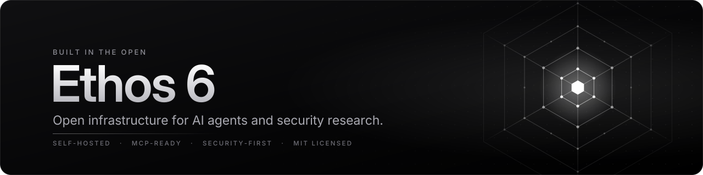

  

  
  
  
  

<h3 align="center">Infrastructure you own. Tools your AI agents can use. No API keys, no usage caps.</h3>

---

### What we build

Ethos 6 builds free, open-source building blocks that people and AI agents can run themselves: web search, document intelligence, storage, live data feeds and security tooling. Everything runs on your own machine or server, talks directly to open sources, and is MIT-licensed.

### Products

| Product | What it does | Built with |
|---|---|---|
| **[Free Search API](https://github.com/Ethos6/free-search-api)** | Keyless, unlimited web search API. Drop-in replacement for Tavily, Serper, Brave Search API and SearXNG, with an MCP server for AI agents. | Python · Docker · MCP |
| **[Free OCR API](https://github.com/Ethos6/free-ocr-api)** | OCR and document data extraction. Turns PDFs, scans, invoices, receipts and bank statements into JSON, CSV or Excel. | Python · Docker · MCP |
| **[Drive Hub](https://github.com/Ethos6/free-drive-hub)** | Joins any number of Google Drive accounts into one self-hosted drive, with a web app, a WebDAV network drive, pooled storage and 2FA. | Python · Docker · WebDAV |
| **[Free Job Search API](https://github.com/Ethos6/free-job-search-api)** | Describe the job you want in plain words or upload your CV, and get the best matching jobs from company career pages, job boards and the web, ranked and explained. | Python · Docker · MCP |
| **[Telegram Drive](https://github.com/Ethos6/free-telegram-drive)** | Turns any number of Telegram accounts into one end-to-end encrypted drive. Files live in your own Saved Messages, with streaming, WebDAV and rebuild from Telegram. | Python · Docker · WebDAV |
| **[SpectraProbe](https://github.com/Ethos6/spectraprobe)** | Static software analysis toolkit. Identifies, hashes and inspects PE, ELF, Mach-O, WebAssembly, APK/JAR archives and JavaScript projects. | TypeScript · CLI · MCP |
| **[Free News API](https://github.com/Ethos6/free-news-api)** | The world's trending news, clustered across 50+ outlets. NewsAPI.org-compatible, with free hosted JSON on GitHub Pages. | Python · Docker · MCP |
| **[Free Flight API](https://github.com/Ethos6/free-flight-api)** | Live flight tracking that merges four open ADS-B networks, with routes, photos, a live map and a streaming feed. | Python · Docker · MCP |
| **[BrowserDock](https://github.com/Ethos6/browserdock)** | Self-hosted headless Chromium as an HTTP API. Send a URL and get rendered text and HTML, a screenshot or a PDF, with API keys, isolated sessions and SSRF protection on every redirect. | TypeScript · Docker · Playwright |

### How we build

- **Own your stack.** Every product self-hosts with Docker or a single install command. Your data stays on your hardware.
- **No keys, no quotas.** Products talk directly to open sources and networks instead of reselling a metered API.
- **Agent-native.** Most products ship a Model Context Protocol server, so AI assistants can use them as tools out of the box.
- **Secure by default.** Every repository runs CodeQL code scanning and Dependabot updates, accepts private vulnerability reports, and protects its `main` branch with required checks.

### Work with us

- **Use it:** pick a product above. Each README has a quick start.
- **Improve it:** issues and pull requests are welcome on every repository.
- **Report a vulnerability:** use **Security → Report a vulnerability** on the affected repository. Please don't open a public issue.

Ethos 6 · Open source, built for the community.

